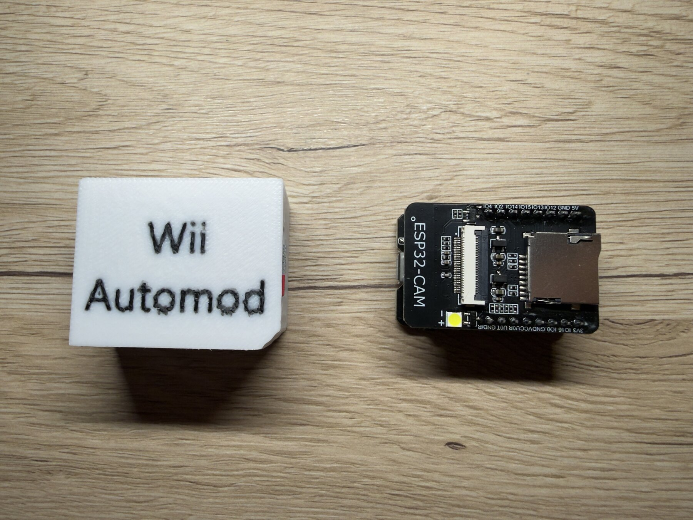
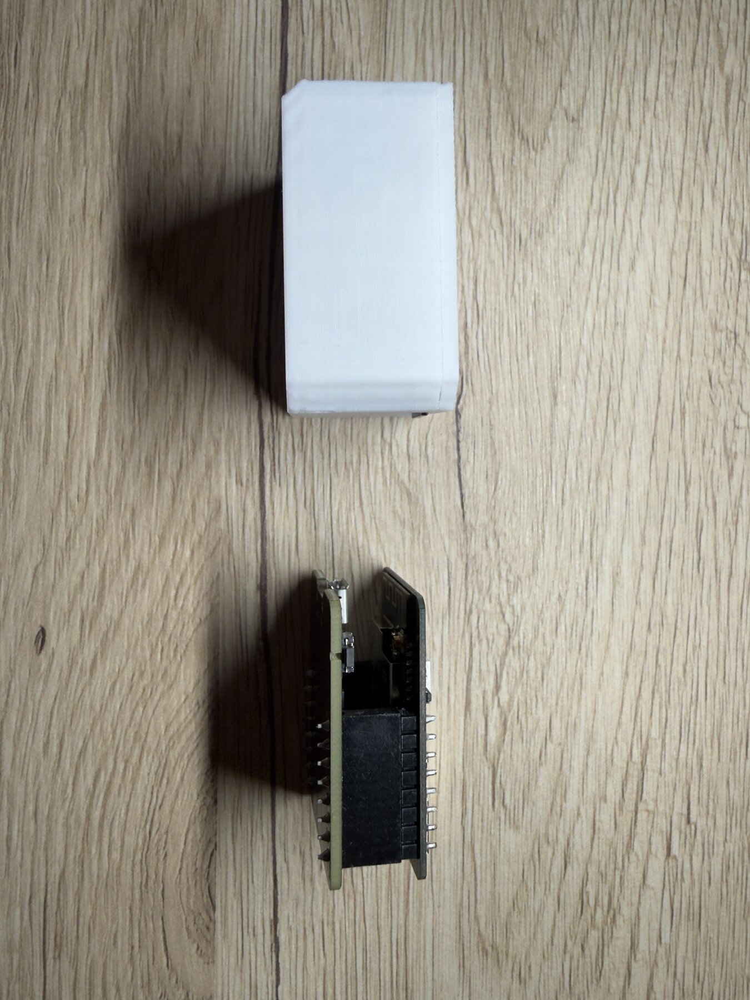
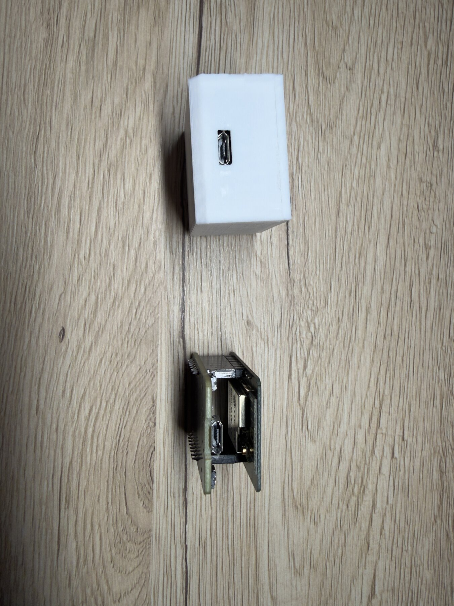

# Hardware

## ESP32-CAM

- Gekauft bei Amazon (Link des Anbieters, ASIN `B0CHYCFFWK`): <https://www.amazon.de/dp/B0CHYCFFWK>. Es handelt sich laut Bestellung um ein **2er-Pack „APKLVSR ESP32-CAM“ mit Programmier-/USB-Platine**. Die Produktseite konnte beim Schreiben nicht automatisch geprüft werden; Angebote ändern sich. **Prüfe die Daten unten, nicht nur den Link.**
- Wichtige Daten des genutzten Moduls: ESP32-CAM (**ESP32-D0WDQ6**, „ESP-32S“-Modul), **4 MB Flash**, **microSD-Steckplatz**, Programmierplatine mit **CH340**-USB-Seriell-Chip und **Micro-USB**-Buchse. Die Kamera (OV2640) wird nicht benutzt.
- Rolle im Projekt: BlueBomb-Bluetooth-Sender, WLAN-Access-Point (fest Kanal 1), Dateiquelle über die microSD, LED-Signal (weiße Blitz-LED) für Statusanzeigen.

### Warum gerade ein ESP32-CAM-Modul?

Der **Hauptgrund ist der eingebaute microSD-Steckplatz**: Die Pakete für die Wii (über 25 MB) liegen auf einer normalen Karte, die man einfach einstecken, am PC befüllen und tauschen kann, ohne zusätzliche Verdrahtung oder Zusatzplatine. Dazu kommen: Bluetooth Classic (nötig für BlueBomb), WLAN (für die Übertragung zur Wii), ein günstiger Preis und die fertige USB-Programmierplatine mit CH340. Die Kamera des Moduls wird **nicht** benutzt; sie ist nur Beigabe. Ein anderes ESP32-Board mit SD-Slot, Bluetooth Classic und WLAN sollte ebenfalls gehen, wurde aber **nicht getestet** (nicht jeder ESP32 kann Bluetooth Classic: S2/S3/C3 können es z. B. nicht).

## ESP-microSD

Wird mit den Installationspaketen bestückt (Inhalt siehe [BUILD.md](BUILD.md)); die Dateien selbst liegen **nicht** im Repo.

## Wii-SD-Karte

Eine normale SD/SDHC-Karte (getestet u. a. 2 GB und größer ab 1 GB). Der WLAN-Lader überträgt die Pakete darauf, der Installer legt Sicherungen und Protokolle dort ab. Der NAND-Dump (ca. 528 MiB) braucht entsprechend Platz.

## Gehäuse (3D-Druck)

Konstruiert in Fusion 360, gedruckt in **PLA, weiß**.

| Datei (`hardware/gehaeuse/`) | Inhalt | Maße |
|---|---|---|
| `Wii-Automod-Gehaeuse_Boden.stl` | Unterteil | 43,2 × 35,1 × 19,7 mm |
| `Wii-Automod-Gehaeuse_Deckel_mit-Schrift.stl` | Deckel mit eingeprägtem „Wii Automod“ | 43,2 × 35,1 × 7,0 mm |
| `Wii-Automod-Gehaeuse_Deckel_ohne-Schrift.stl` | Deckel ohne Schrift | 43,2 × 35,1 × 7,0 mm |
| `Wii-Automod-Gehaeuse_Fusion.f3d` | Fusion-360-Quelle | – |

Öffnungen (aus den Fotos): eine Seite für die microSD-Karte, eine Seite für den USB-Anschluss zur Wii, die Stirnseite für die Micro-USB-Buchse. Das Gehäuse ist „nicht perfekt, aber es reicht“ – Verbesserungen sind willkommen. Die Maße stammen aus den STL-Dateien, die Passung wurde nur mit dem oben beschriebenen Modul geprüft.

## Getestete Wii-Editionen

Siehe [TESTED-ON.md](TESTED-ON.md): getestet wurde an einer schwarzen **Wii Family Edition (RVL-101**, ohne GameCube-Anschlüsse) und drei weißen **Original-Wiis (RVL-001)**.

## Anschluss an der Wii

Der ESP wird über das Gehäuse an eine **USB-Stromquelle bzw. den Wii-USB-Port** angeschlossen (nur Strom; die Kommunikation läuft über Bluetooth und WLAN). Bluetooth-Reichweite: ESP in der Nähe der Wii halten.
